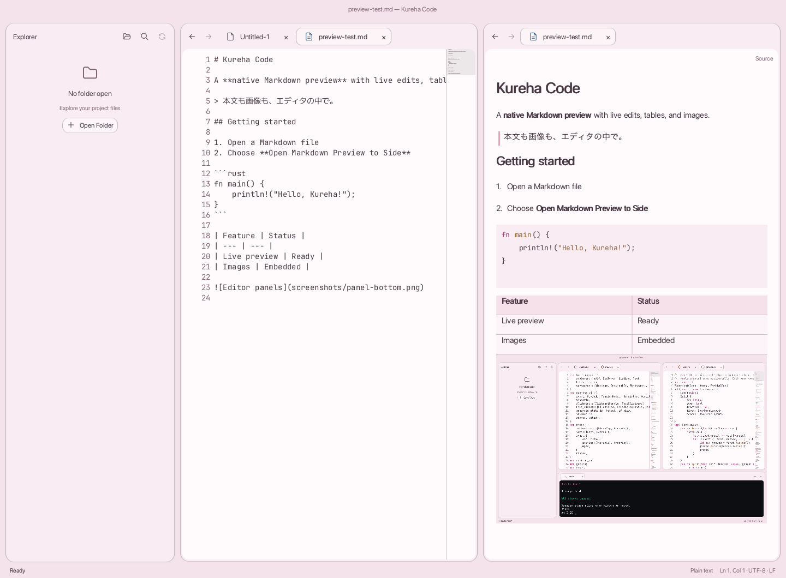

# Kureha Code

A native, cross-platform code editor written in pure Rust with ScarletUI.



## Build and run

With Nix and flakes enabled:

```sh
nix develop
cargo run -- path/to/file-or-directory
```

The development shell supports Linux x86_64/AArch64 and macOS Apple Silicon.
With direnv, run `direnv allow` to load it automatically.

## Package

Build a release package with Nix (no development shell required):

```sh
nix build
```

On macOS, open `result/Applications/Kureha Code.app` or copy it to Applications.
On Linux, run `result/bin/kureha-code`; its wrapper supplies the Nix runtime
libraries and a default font configuration. For desktop launchers, install the
flake with `nix profile add .#kureha-code`, or add `result/bin` to `PATH` and
`result/share` to `XDG_DATA_DIRS`. The build uses the pinned Rust toolchain,
vendors the locked Cargo dependencies and packages the executable, icons and
resources with [Appcoat](https://github.com/petitstrawberry/appcoat).
macOS packages are not distribution-signed or notarized.

The packaging helper also works without Nix. Install Rust/Cargo, Python 3.11 or
newer, and [Appcoat](https://github.com/petitstrawberry/appcoat), with `cargo` and
`appcoat` on `PATH`. To install the same Appcoat revision used by the flake:

```sh
cargo install --git https://github.com/petitstrawberry/appcoat \
  --rev 3ddff8882449d82ce4c8829d538b0157b5ff0096 --locked appcoat_cli
python3 scripts/package.py
```

The script builds a release executable with Cargo and packages it with Appcoat.
macOS packaging requires Apple's command-line tools. On Linux, install
`pkg-config`, Fontconfig development files, native runtime libraries and graphics
drivers separately; the helper does not bundle runtime libraries.
The Nix development shell provides the tools and Linux runtime libraries
as another way to run the same helper:

```sh
nix develop --command python3 scripts/package.py
```

Use `--artifact /path/to/kureha-code` to package an existing binary, or
`--output /path/to/new-package` to choose another destination. Existing packages
are never overwritten. This helper writes to `dist/macos/Kureha Code.app` or
`dist/linux/kureha-code` by default. On macOS, open the generated `.app` or copy it
to Applications. On Linux, run `bin/kureha-code` inside the generated directory;
desktop launchers need its `bin` on `PATH` and `share` on `XDG_DATA_DIRS`.

For Scarlet, package an executable built for your image
before using the [Scarlet bundle](platforms/scarlet/bundle.toml):

```sh
python3 scripts/package.py --platform scarlet --target aarch64-unknown-scarlet \
  --artifact /path/to/scarlet/kureha-code
```

`riscv64gc-unknown-scarlet` is also accepted. The bundle consumes the resulting
`dist/scarlet/kureha-code.app`; build it for the architecture of your image.

## Configuration

Open the Settings tab with **Kureha Code → Settings…** (`⌘,` on macOS, `Ctrl+,` elsewhere).
Theme choices, code font size and minimap visibility are saved automatically.
Settings also includes the bundled dependency, font and theme acknowledgements.

**Open Settings File…** opens `~/.config/kureha-code/settings.toml`.
**Edit Custom Theme…** opens `~/.config/kureha-code/theme.toml`;
see the [configuration example](assets/theme.toml) for available overrides.

Language servers must be installed separately. Override their commands in
`~/.config/kureha-code/lsp.toml`:

```toml
[servers.rust]
command = "/path/to/rust-analyzer"
args = []
```

Configuration paths respect `$XDG_CONFIG_HOME`.

## Development

Run tests inside the development shell:

```sh
cargo test --lib --bin kureha-code
```
