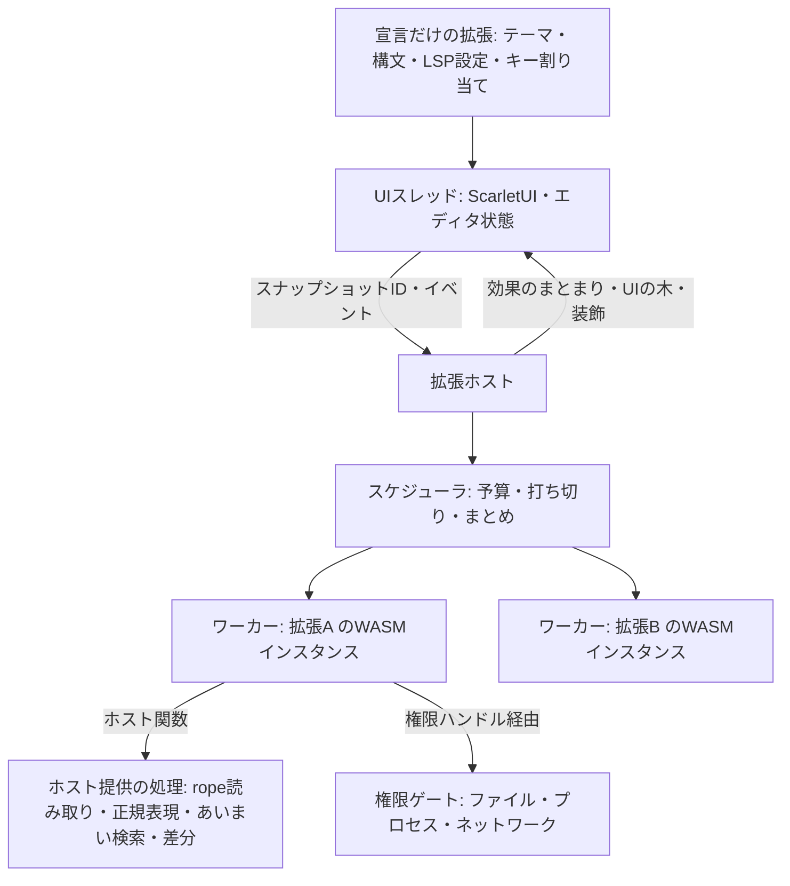

# 拡張機能の設計

2026-11-11。設計案。数値(予算、上限)はすべて仮の値で、
Scarlet実機と開発機で測ってから決める。実装済みの範囲は末尾の「実装状況」を参照。

## 結論

**拡張はWASMで動かし、描画も権限もホストが握る。**
拡張は「データを返す関数」と「権限つきの非同期タスク」だけを書く。
UIは部品の木をデータで返し、ホストがScarletUIで描く。
宣言だけで済む拡張(テーマ、構文定義、LSP設定)はコードを実行しない。

目標は次の3つ。

- 拡張がどれだけ遅くても、入力・スクロール・描画が止まらない。
- 拡張は、マニフェストで宣言し許可された範囲の外に一切触れない。
- 同じ拡張パッケージが macOS / Linux / Scarlet(aarch64, riscv64)で動く。

対象外。

- 拡張による自由な描画(WebView)を標準にすること。逃げ道としてだけ残す。
- 拡張同士の直接呼び出し。必要になったら型つきの公開インターフェースを別に設計する。
- Node / VS Code拡張との互換。

## 全体構成



- UIスレッドはWASMを実行しない。`lsp::Client` と同じく、チャネルで送り `poll` で受け取る。
- 拡張1つにつきWASMインスタンス1つ。メモリ上限と実行量の上限を個別に持つ。
- 拡張が落ちても、その拡張の表示が消えるだけでエディタは続行する。

## 拡張の2段階

| 段階 | 中身 | 実行されるコード |
| --- | --- | --- |
| 宣言だけ | テーマ、構文定義(`.sublime-syntax`)、言語設定、LSPサーバーの起動設定、スニペット、キー割り当て | なし |
| ロジックつき | 上記に加えて `.wasm` | 必要になった時点で初めてインスタンス化 |

ロジックつき拡張の起動条件はマニフェストに書く(特定言語のファイルを開いた、
コマンドが呼ばれた、ビューが表示された)。起動時に全拡張を走らせることはしない。

## マニフェスト

```toml
[extension]
id = "example.todo-highlight"
name = "TODO Highlight"
version = "0.1.0"
api = 1                      # ホストAPIの世代。合わなければ読み込まない
wasm = "extension.wasm"      # 宣言だけの拡張では省略

[activation]
languages = ["rust", "markdown"]
commands = ["todo.list"]

[capabilities]               # 書かなければ何もできない
workspace = "read"           # "none" | "read" | "read-write"
process = []                 # 起動してよい実行ファイル名
environment = false          # 開いたフォルダの環境変数を提供する(direnvなど)
network = []                 # 接続してよいホスト名
clock = false                # 時刻・乱数。falseならクエリは決定的になる

[[contributes.commands]]
id = "todo.list"
title = "TODOを一覧表示"

[[contributes.views]]
id = "todo.panel"
title = "TODO"
location = "side"            # "side" | "bottom" | "tab"

[[contributes.themes]]
path = "themes/dark.toml"

[[contributes.language_servers]]
language = "rust"
command = "rust-analyzer"    # capabilities.process にも必要

[[contributes.keybindings]]  # 自分のコマンドだけ。Altを含むか、ファンクションキー
command = "todo.list"
key = "Alt+Shift+T"

[[contributes.formatters]]   # Format Document と保存時の整形を引き受ける
languages = ["markdown"]

[contributes.environment]    # capabilities.environment が必要
files = [".envrc"]           # フォルダ直下にあれば、この拡張に環境を問い合わせる
watch = ["flake.nix"]        # 保存したら問い合わせ直す(files も含む)
```

## 入口は2種類

### クエリ(副作用なし)

ホストが必要なときに呼ぶ関数。入力はスナップショットIDと範囲、出力はデータ。

| クエリ | 返すもの |
| --- | --- |
| `decorations(snapshot, range)` | 装飾の範囲と種類 |
| `completions(snapshot, position)` | 補完候補 |
| `hover(snapshot, position)` | ホバーの中身(Markdownまたは部品の木) |
| `view(view_id)` | UIの部品の木 |
| `rows(view_id, list_id, range)` | 長いリストの見えている行 |

決まりごと。

- 権限が必要なホスト関数は呼べない。読めるのはスナップショットと自分の状態だけ。
- 見えている範囲だけ呼ぶ。結果は (拡張の状態の版, スナップショット, 範囲) でキャッシュする。
- 新しい入力が来たら実行中の呼び出しを打ち切る。
- 予算(仮: 1回 2ms 相当の実行量)を超えたら打ち切り、古い結果を表示し続ける。
  超過が続く拡張は呼び出し頻度を下げ、UIに「遅い拡張」として表示する。

### タスク(副作用あり)

コマンド実行、保存時の整形、外部ツール呼び出しなど。

- 非同期で動き、キャンセルできる。進捗を報告できる。
- 権限つきのホスト関数はここからだけ呼べる。
- 文書の変更は「効果のまとまり」として返す。ホストは対象文書の版が一致するときだけ
  一括適用する。一致しなければ破棄してタスクに通知する。undoは1単位になる。

```text
Effects {
  base: { document, version },
  edits: [ { range, text } ],
  diagnostics: [...],
  notifications: [...],
}
```

## テキストの受け渡し

- バッファは `lapce_xi_rope` の rope で、複製がほぼ無料。編集のたびに版を進め、
  拡張にはスナップショットIDだけ渡す。
- 拡張は `read(snapshot, range)`、`line(snapshot, n)`、`len(snapshot)` で必要な分だけ読む。
- 文書全体を毎回送らない。UIスレッドのロックも要らない。
- スナップショットは参照している呼び出しが終わったら解放する。

## ホストが提供する処理

WASM側は薄く保ち、重い処理はネイティブで実行する。Scarletではインタプリタ実行に
なるため、ここが速度を決める。

| 分類 | 関数の例 |
| --- | --- |
| テキスト | 範囲読み取り、行と位置の変換、正規表現検索(スナップショットに対して直接) |
| 検索 | あいまい検索、ワークスペース内検索 |
| 構文 | トークン種別の問い合わせ(既存の `syntax.rs` の結果を公開) |
| 差分 | 2つのテキストの差分から編集列を作る |
| 設定 | 拡張ごとの名前空間の設定値 |

最初の品揃えは実際に作る拡張2〜3個から逆算して決める。

## 一覧と有効・無効

サイドバーの「拡張機能」で、インストールされた拡張(名前、ID、版、追加するもの、読み込みのエラー)を一覧し、
1つずつ無効・有効にできる。選んだ状態は設定の `[extensions] disabled = ["id", ...]` に保存し、
`allow_process` の許可は無効にしても消さない。

- 無効にした拡張は、コマンド、キー割り当て、フォーマッタ、言語、言語サーバー、テーマの一覧から
  すぐに消える(`Registry` の各アクセサが有効なものだけを返す。サイドバーの一覧だけはすべてを見る)。
- 拡張のワーカーも、無効な拡張への依頼を毎回断る。呼び出し側が見落としても動かない。
- 有効に戻すと、再起動なしで戻る。
- 例外: 適用中のテーマは、別のテーマを選ぶまでそのまま。起動済みの言語サーバーは、エディタを
  再起動するまで動き続ける。拡張の追加と削除は、再起動で読み込み直す。

## 権限

- 権限は「ハンドル」で渡す。拡張は任意のパス文字列を開けない。
  `workspace = "read"` なら、ワークスペース直下を指す読み取り専用ハンドルを1つ受け取る。
  `..` やシンボリックリンクでの外部への到達はホスト側で拒否する。
- プロセス起動は宣言した実行ファイル名だけ。宣言は作者の要求にすぎないので、実際に動くのは
  ユーザーが拡張とプログラムの組ごとに許可したものだけ(段階4で実装)。引数はタスクが指定し、
  作業ディレクトリは文書のフォルダか開いているフォルダから選ぶ(任意のパスは不可)。
- ネットワークは宣言したホスト名だけ。Scarletでは当面未対応として `unsupported` を返す。
- 時刻と乱数も権限。なければクエリは決定的で、テストと再現が容易になる。
- インストール時と更新で権限が増えた時に、ホストが描くダイアログで確認する。
- 拡張ごとの実行時間、メモリ、打ち切り回数を記録し、設定画面で見られるようにする。

## GUI

4段階に分ける。1と2で大半をまかなう。

| 段階 | 内容 | 時期 |
| --- | --- | --- |
| 1. 差し込み口 | コマンド、ステータスバー項目、コンテキストメニュー、選択リスト、通知、入力ボックス | 最初 |
| 2. 宣言的ビュー | 部品の木を返し、ホストがScarletUIで描く | 2番目 |
| 3. キャンバス | 描画命令の列を返す。クリック判定は領域単位 | 後から |
| 4. WebView | `docs/webview.md` の `myrica-webview` を権限つきで開放 | 未定 |

### 宣言的ビュー

`view(view_id)` は拡張の状態から部品の木を返すクエリ。拡張は状態が変わったら
`invalidate(view_id)` を呼ぶだけで、ホストが1フレームに1回にまとめて `view` を呼ぶ。

最初の部品。

| 部品 | 主な属性 | 届くメッセージ |
| --- | --- | --- |
| `column` / `row` | 間隔、揃え、子 | なし |
| `text` | 文字列、強調、色の役割(テーマの名前で指定) | なし |
| `button` | ラベル、アイコン、無効 | 押された |
| `input` | 初期値、プレースホルダ | 変更(まとめて)、確定 |
| `list` | 件数、行の高さ種別 | 行の選択、行の実行 |
| `tree` | ルートの件数 | 開閉、選択、実行 |
| `separator` / `spacer` | なし | なし |

後から足す候補: `table`、`image`、`markdown`、`checkbox`、`select`、`progress`。

決まりごと。

- 操作中の状態(スクロール位置、フォーカス、入力欄の中身、ホバー、選択)はホストが持つ。
  文字入力やスクロールでWASMを待たない。IMEもホストが処理する。
- 部品にはキーを付ける。ホストは前回の木との差分だけ反映する。
- `list` と `tree` は件数だけ返し、行は `rows` クエリで見えている範囲だけ引く。
- 色と文字サイズは直接指定させず、テーマの役割名(`text.muted`、`accent` など)で指定させる。
- メッセージは `(view_id, key, 種別, 値)` の形でタスクとして届く。

### エディタ内の表示

ビューとは別の専用データ型にする。

| 種類 | 内容 |
| --- | --- |
| 範囲の装飾 | 文字色、背景、下線(テーマの役割名で指定) |
| 行頭の印 | アイコンと色 |
| 行内のヒント | 行末または位置指定の補助テキスト |
| 行間のブロック | 行の下に差し込む部品の木(高さはホストが決める) |

### 画面上の安全

- 拡張は自分のビューの中にしか描けず、他の画面の内容は読めない。
- 入力イベントは自分のビューにフォーカスがある間だけ届く。
- 権限の確認などホストのダイアログは拡張から出せない。拡張のビューには拡張名を表示する。

## ランタイムとABI

- 最初は全プラットフォームで **wasmi**(純Rustのインタプリタ)。Scarletへの移植が最も軽く、
  実行量の上限(fuel)とメモリ上限を備える。
- ABIはランタイムに依存させない。デスクトップで後からJIT(wasmtime)に差し替えられる。
- コンポーネントモデル / WITは使わない(wasmiが未対応のため)。型定義はRustのSDKクレートを正とする。

拡張が公開する関数。

```text
kx_alloc(len: u32) -> ptr: u32
kx_free(ptr: u32, len: u32)
kx_call(ptr: u32, len: u32) -> u64        // 上位32bit=ptr、下位32bit=len
```

ホストが公開する関数(インポート元のモジュール名は `kureha`)。

```text
kx_host(ptr: u32, len: u32) -> i64        // 要求を処理し、返事の長さを返す(負なら失敗)
kx_host_take(ptr: u32, len: u32) -> i32   // 保留中の返事を拡張のメモリへ書き込む
```

- ホストが拡張の `kx_alloc` を呼び返すと再入になるため、返事は「長さを受け取る →
  拡張が確保 → `kx_host_take` で写す」の2段階で渡す。
- `kx_call` に渡したバッファと、`kx_call` が返したバッファは、どちらもホストが `kx_free` で解放する。
- 拡張が `kureha` の2関数以外をインポートしていたら読み込まない(WASIも渡さない)。
- 引数と戻り値は1つのメッセージをバイト列にしたもの。段階2ではJSONにした(既存の依存だけで済み、
  デバッグしやすい)。枠組みは形式に依存しないので、速度が問題になればpostcardへ替えられる。
- `kx_call` に渡すメッセージ: `Activate`、`Query`、`TaskStart`、`TaskEvent`、`UiMessage`、`Deactivate`。
- タスク中の待ちが発生する操作(ファイル読み書き、プロセス、ネットワーク)は、
  `kx_host` が要求IDだけ返し、完了時にホストが `TaskEvent { id, result }` で起こす。
  SDKはこれを `async fn` として見せる。WASMのスレッドは使わない。
  **段階4ではこれをやめ、プロセスは同期呼び出しにした**(拡張ごとにワーカースレッドを分けたので、
  待つのはその拡張だけ)。1つの拡張が複数のタスクを並行して進めたり、実行中のタスクを取り消したり
  する必要が出たら、この非同期の形に戻す。
- クエリ中は待ちが発生する操作を呼べない。呼んだら即エラーを返す。

## スケジューラ

- 拡張ごとにキューを持つ(段階4で実装: 拡張ごとのワーカースレッド)。文書変更の通知は最新の1件にまとめる。
- 優先順位: UIメッセージ、見えている範囲のクエリ、タスク、見えていない範囲の先読み。
- ワーカーは拡張ごとに1本(段階4)。拡張が増えてスレッド数が問題になったら、Scarletではコア数に合わせた
  少数のプールに戻し、待ちの発生する操作だけ別スレッドに逃がす。
- メモリ上限(仮: 64MB)を超えた確保は失敗させる。繰り返し落ちる拡張は無効化して通知する。

## 配布

- `extension.toml`、`.wasm`、アセットを1つのアーカイブにする。
- 取得元とSHA-256を固定する。PR #15 で入れるアーカイブとチェックサムつき
  マニフェストの仕組みと同じ考え方にそろえる。
- 配置先はユーザー設定ディレクトリの `extensions/<id>/<version>/`。更新は新しい版を
  展開してから切り替え、失敗したら前の版に戻す。
- 今あるのはビルドの手順だけ(下)。アーカイブとインストーラはまだない。

**ビルド**: `scripts/build-extension.py`。拡張のソースは `extension.toml` の隣のCargoプロジェクトで、
マニフェストはインストールしたフォルダを表す(`wasm = "extension.wasm"`)。スクリプトはwasm32向けに
ビルドし(モジュールはCargoの報告から取る)、マニフェスト、モジュール、マニフェストが参照するファイル(テーマ)、
README・LICENSEだけを `<出力先>/<名前>.kx/` に置く(名前はソースのフォルダ名)。ソースとCargoのファイルは持っていかない。

- `--install` でKurehaの読み込み先(`KUREHA_EXTENSIONS_DIR`、なければ `$XDG_CONFIG_HOME/kureha-code/extensions`)、
  `--out <フォルダ>` で任意の場所、どちらもなければ `dist/extensions`。引数なしで `extensions/` と例をすべてビルドする。
- Kurehaは `.kx` のないフォルダも読み込む。名前は目印で、読み込みの条件ではない。
- 隠しフォルダに組み立ててから入れ替えるので、ビルドに失敗しても前のものが残る。
- 同じidを持つ別の項目があると、Kurehaは1つしか読み込まない。シンボリックリンク(以前の手順でソースの
  フォルダをリンクしたもの)なら外し、実体のフォルダなら止まる。別の拡張が入っているフォルダも上書きしない。
- 開発中もソースを直接読み込ませず、変更のたびにこれを実行し直す。

## 進め方

1. 宣言だけの拡張。拡張ディレクトリの走査、マニフェスト、テーマ・構文・LSP設定の読み込み。
2. wasmiホストの最小版。`decorations` クエリ1種類と、コマンドのタスク1種類。
   ここでScarlet実機と開発機の両方で予算に収まるか測る。成立しなければABIと
   ホスト提供の処理を見直す。
3. 差し込み口(ステータス項目、選択リスト、通知)と権限ゲート。
4. 宣言的ビュー。部品は `column`、`row`、`text`、`button`、`input`、`list`、`tree` から。
5. Rust向けSDKクレートとサンプル拡張。API世代を1として固定する。
6. キャンバス、配布の自動更新、JITへの差し替えは需要が出てから。

## 未決事項

- メッセージ形式。段階2はJSONで実装した。postcardへ替えるかは、Scarletでの測定次第。
- 予算の単位。wasmiのfuelを時間に換算するか、実行量そのままで管理するか。
- 構文情報をどこまで公開するか。syntectのスコープ名をそのまま出すと将来の差し替えが難しくなる。
- 保存時の整形のように「結果を待つ」必要がある場面の扱い。待ち時間の上限と、超えた場合の挙動。
- 拡張の状態を再起動後に引き継ぐ保存領域を、最初のAPIに含めるか。
- Rust以外の言語でのSDK(少なくともABIの文書化)をいつ用意するか。

## 実装状況

### 段階1: 宣言だけの拡張(実装済み)

`src/extensions.rs`。WASMはまだ実行しない(`wasm` はパスの検証だけ)。

- 置き場所は `KUREHA_EXTENSIONS_DIR`、なければ `$XDG_CONFIG_HOME/kureha-code/extensions`
  (`XDG_CONFIG_HOME` が空なら `~/.config`)。その直下のフォルダごとに `extension.toml` を読む。
  `.` で始まるフォルダは無視する。版ごとのフォルダ(`<id>/<version>/`)はインストーラと一緒に入れる。
- 起動時にワーカースレッドで一度だけ読み込む。UIスレッドは読み込み済みかどうかだけを見て、
  ディスクに触れない。変更を反映するには再起動が必要。
- マニフェストは未知のキーを拒否する。`api` が一致しないもの、id が重複したものは読み込まない。
  読み込めなかった拡張はステータスバーに1行で報告する。
- パスは相対パスだけ受け付け、シンボリックリンクで拡張フォルダの外へ出るものを拒否する。

反映される貢献。

| 貢献 | 反映先 | 優先順位 |
| --- | --- | --- |
| `themes` | テーマ選択の一覧、設定ファイルの `color_theme` / `code_theme` | 同名なら組み込みテーマが優先 |
| `languages` | ファイル拡張子から言語IDへの対応 | 組み込みの対応が優先(`.rs` などは奪えない) |
| `language_servers` | LSPサーバーの起動設定 | 環境変数 `KUREHA_LSP_<LANG>` > `lsp.toml` > 拡張 > 組み込み |

`language_servers` の `command` は `[capabilities] process` にも書かれていないと読み込まない。
`commands`、`views`、`activation`、`capabilities` の残りは解析と検証のみで、まだ使われない。

### 段階2: wasmiホストの最小版(実装済み)

`src/extensions/runtime.rs`(1拡張のインスタンス)、`src/extensions/host.rs`(ワーカー)、
`src/extension_ui.rs`(コマンドパレットと結果の適用)。

- wasmi 2.0。デスクトップは `auto-dispatch`、Scarletは末尾呼び出しの最適化に頼らない
  `portable-dispatch`。`wat` はテスト専用で、配布物と謝辞には入らない
  (`about.toml` で開発用依存を除外)。
- WASMは専用スレッド `extension-host` だけで動く。UIは要求を送り、`poll_extensions` で返事を受け取る。
  拡張は最初に使われたときにインスタンス化して `activate` を送る。
- 1回の呼び出しごとにfuelを設定する。既定値は `Budgets::default()`(起動 2000万、
  クエリ 200万、タスク 10億)。メモリは64 MiB、`.wasm` は16 MiB、メッセージは1 MiBまで。
  タスクは当初1億にしたが、Text Toolsで192 KiBのJSON整形が2.7億を使ったため10億に上げた。
- ホスト関数の処理もfuelで払わせる(1回1万 + 読み書きしたバイト数×4)。払えなければ予算超過になる。
  これがないと、拡張が `read` を繰り返すだけでワーカーを占有できてしまう。
- 予算超過やトラップで止まったインスタンスは、状態が壊れている可能性があるので捨てて次回作り直す。
  予算超過が3回続いた拡張は再起動まで無効にする。
- 拡張から来たポインタと長さはすべて範囲検査する。編集と装飾の範囲は、スナップショットの
  文字境界にあり、重ならないことを確かめてから使う。
- ホストの関数は `read`(呼び出し中のスナップショットから範囲を読む)と `log` だけ。
  権限が要る操作はまだない。
- コマンドは、マニフェストに `wasm` がある拡張のものだけをコマンドパレットに
  「拡張名: タイトル」で出す。行のキーは `ext:<拡張id>:<コマンドid>` で、組み込みと衝突しない。
- コマンドの編集は、言語サーバーの編集と同じ確認を通して1回のundoで適用する。
  実行中に文書や作業中のエディタが変わっていたら捨てて、ステータスバーに理由を出す。
- テキストは rope のスナップショットではなく、`Arc<String>` の複製を渡している。

`decorations` クエリは、ABI・検証・予算までは実装してテストしたが、エディタへの描画はまだない。

計測(Apple Silicon、macOS、リリースビルド)。

- fuelは命令の数え方で決まり、プラットフォームによらず同じ値になる。予算に対する余裕(fuelの割合)は
  Scarletでも変わらず、変わるのは実時間だけ。
- 1 msあたりのfuelは処理で違う。空ループは約230万fuel/ms(`fuel_throughput`)、Text Toolsの実際の
  コマンドは約450万〜970万fuel/ms。空ループから時間を見積もると長めに出る。
- 既定のタスク予算(10億)は、このMacで約0.1〜0.2秒に当たる。
- upper-caseの例で100 KBの選択範囲を大文字にすると、1回約1.3 ms。
- Text Toolsの入力上限(192 KiB)での各コマンドは次のとおり(`text_tools_budget`)。

| コマンド | fuel | タスク予算に対して | 時間 |
| --- | --- | --- | --- |
| Convert to snake_case(184 KiB) | 4.99億 | 50% | 63 ms |
| Format Selection as JSON | 2.72億 | 27% | 57 ms |
| Minify JSON | 1.53億 | 15% | 30 ms |
| URL Encode(184 KiB) | 1.01億 | 10% | 16 ms |
| Sort Lines | 0.84億 | 8% | 17 ms |
| Trim Trailing Whitespace / Count / Base64 Encode | 0.47億〜0.49億 | 5% | 5〜10 ms |

**Scarlet実機での計測はまだで、段階2の関門(予算内に収まるか)は未確認。** 予算の値はその結果で見直す。

実アプリの経路の確認: `cargo test --bin kureha-code extension_command_end_to_end -- --ignored`
(`scripts/build-extension.py --out <フォルダ>` でビルドした例を置き、`KUREHA_EXTENSIONS_DIR` にそのフォルダを指定する)。本物のコマンドパレット、ワーカー、例の拡張を通し、
選択範囲が大文字になり1回のundoで戻ることを確かめる。`KUREHA_WORKBENCH_PREVIEW` を指定すると画面をPNGで保存する。
macOSのデバッグビルドで、Enterから編集の適用まで初回読み込み込みで約25 ms。

例とSDK(どれも本体のビルド、`Cargo.lock`、謝辞、CI、`nix build` の対象外):

- `examples/extensions/sdk`(`kureha-extension`): ABIの糊だけを切り出した最小のSDK。
  バッファのエクスポート、`kx_host` の2段階呼び出し、JSONの読み書きを隠し、`export!(handler)` で
  エクスポートを生成する。FFIは `wasm32` のときだけ有効なので、変換処理はネイティブでテストできる。
- `examples/extensions/text-tools`: 実用向けの例。行の並べ替え・重複削除・反転、行末空白の削除、
  JSONの圧縮と、他のファイルに埋め込まれたJSONの選択範囲の整形(キー順と数値の表記を保つ。JSONファイル
  自体の整形は整形器としてFormat Documentが受け持つ)、大文字小文字や snake_case などの変換、
  Base64・URLのエンコードとデコード、行数・単語数・文字数。行のコマンドは選択行(なければ文書全体)、
  変換系は選択範囲だけに効く。CRLFと末尾の改行を保ち、入力は192 KiBまで。
- `examples/extensions/upper-case`: 最小の例。選択範囲を大文字にする。

`examples/extensions/upper-case` は選択範囲を大文字にする拡張で、SDKを使って書いている。
`cargo test real_guest -- --ignored` に `KUREHA_TEST_EXTENSION_WASM` を渡すと、ビルド済みの
モジュールをランタイムに通して確かめられる。

実アプリの経路では `text_tools_end_to_end` も同様に、コマンドパレットからJSONの整形と
CONSTANT_CASEへの変換を実行し、2回のundoで元に戻ることを確かめる。

### 段階3: キー割り当てと整形の枠組み(実装済み)

**キー割り当て**(`contributes.keybindings`)

- 自分の拡張のコマンドにだけ付けられる。書式は組み込みと同じ `Alt+Shift+S`、`Primary+Alt+L`、`F6`。
  `Primary` はmacOSでCommand、それ以外でCtrl。キーの連続(`Primary+K Primary+T`)は不可。
- 拡張が使えるのは **Altを含む組み合わせか、ファンクションキー** で、キーは英字・数字・F1〜F24。
  組み込みのショートカットはほぼAltを使わないので衝突しにくく、普通の文字入力も奪わない。
- 組み込みと重なるものは読み込み時に捨てる。対象はコマンドパレットとメニューに載るもの全部、
  載っていない組み込み(Alt+Z、Alt+Shift+F、F1/F2/F3/F12 など)、Primaryと一緒なら他の修飾キーに
  関係なく取られるキー(N、O、S、W、数字など)。拡張どうしで重なったら先に読み込んだ方が勝つ。
  捨てたものはステータスバーに1回だけ出す。
- 効くのはコードエディタにフォーカスがある間だけ(VS Codeの `editorTextFocus` 相当)。
  検索欄・名前の変更・ターミナルでは効かない。Altの後に一部の環境が送ってくる文字は捨てる。
- コマンドパレットの行にショートカットを表示する。

**整形の枠組み**(`contributes.formatters`)

- 拡張は「この文書全体を整形した編集を返す」だけを実装する(ABIの `"kind": "format"`。
  `options` に言語サーバーへ渡すのと同じ `tab_size` と `insert_spaces`)。どのコマンドで呼ぶか、
  いつ呼ぶか、どの整形器を使うかはホストが決める。
- 組み込みの **Code: Format Document**(Alt+Shift+F)は、その言語の整形器が拡張ならそちらを、
  そうでなければ従来どおり言語サーバーを使う。拡張がなければ動作は今までと同じ。
- 選び方: 設定ファイルの `[formatter]` に言語ごとに `"lsp"` か拡張のidを書けばそれ。書かなければ
  最初に読み込まれた拡張の整形器、なければ言語サーバー。成功すると「Formatted with 拡張名」と出す。
- **保存時の整形**(設定の `format_on_save`、設定画面にトグル): 保存を一度止め、整形を当ててから書き込む。
  - どう失敗しても保存はする。整形器のエラー、予算超過、途中で文書が編集された場合は整形せずに保存し、
    「Saved 名前 · not formatted: 理由」と出す。
  - 1.5秒で返事がなければ整形せずに保存し、遅れて来た返事は捨てる(保存後に文書を変えない)。
  - 整形待ちの間にもう一度保存しても、整形を二重に始めない。
  - 返事が来たときに別のファイル操作やダイアログが動いていれば、終わるのを待ってから保存する
    (保存処理はその間は何もせずに戻るため)。ファイル操作が始まると編集の保護条件で整形は捨てられるので、
    そのときは整形せずに保存する。
  - 閉じるときの「保存しますか」から保存する場合は待たない。「すべて保存」も今は整形しない。
  - 言語サーバーの整形はまだ保存時に走らない(その旨を1回だけ表示する)。
- 例: Text ToolsはJSONの整形器になり、Alt+Shift+S/D/U/L/C のキー割り当てを持つ。

確認: `extension_ui` のテストで、組み込みや重複の除外、キーからのコマンド実行、Altの後の文字の破棄、
整形器の選択と `[formatter]` による切り替え、保存時の整形(成功、エラー、途中の編集、時間切れと遅れた返事、
閉じるときの保存、別の保存の最中に返事が来た場合)を確かめる。キー割り当ては、実際のウィンドウの
イベント経路(クリックでエディタにフォーカス → Alt+Shift+Kの押下・文字・離す)でもコマンドが動き、
Altの後の文字が入力されないことを確かめる。`text_tools_formatter_and_keys_end_to_end` は実際のText Toolsで
Format Document、保存時の整形、Alt+Shift+S、パレットのショートカット表示を通す。

段階3の時点でAPIでできなかったこと: 時刻・乱数(UUIDや日時の挿入)、ファイルへのアクセス、
拡張ごとの設定、装飾の描画。プロセス(外部ツールの整形器)は段階4で使えるようになった。

### 段階4: 外部プログラムの起動(実装済み)

`src/extensions/process.rs`(許可と実行)、`runtime.rs` の `process` 要求、`extension_ui.rs` と
`navigation_ui.rs`(コマンドパレットでの許可)。

**ワーカーを拡張ごとに分けた。** 以前は全拡張で1本のスレッドだったので、ある拡張がプログラムの終了を
待つと他の拡張がすべて止まった。今は拡張ごとのスレッドが最初の利用時に立ち上がる。

**権限は2段階。** マニフェストの `[capabilities] process` は作者の要求で、それだけでは何も動かない。

- ユーザーがコマンドパレットの **Extensions: Allow <拡張id> to Run <プログラム>** で許可したものだけ動く。
  許可済みなら **Extensions: Stop <拡張id> Running <プログラム>** が代わりに出る。ラベルには拡張の表示名ではなく
  idとプログラム名をそのまま出す(表示名は検索語にだけ使う)。
- 許可した直後のステータスで「そのプログラムを任意の引数で、あなたの権限で実行できる」と伝える。
  `sh`・`node`・`git` のようなプログラムを許可するのは、任意のコードの実行を許すのと同じ。
- 許可は設定ファイルの `[extensions.allow_process]` に保存する(`"拡張id" = ["ruff"]`)。設定を読み込んだとき・
  変えたときにワーカーへ反映するので、再起動は要らない。取り消しも次の呼び出しから効く。
- 許可がないと拡張には「needs your permission to run `ruff`; run "Extensions: Allow … to Run ruff" from the
  command palette」というエラーが返り、拡張はそれをそのまま表示できる。
- **拡張が提供する言語サーバーも同じ許可が要る。** 以前はマニフェストの `language_servers` と
  `process` に書くだけで、開いたファイルに合わせて自動で起動していた(実質的に権限の抜け道だった)。

**実行のしかた**(`process` 要求、同期)

- コマンドと整形の中だけ。`activate` と `decorations`(クエリ)では断る。
- シェルを通さない。プログラムは絶対パスの `PATH` 要素からだけ探し、見つけた絶対パスで起動する。
  `.` や `node_modules/.bin` のような相対要素は子プロセスの作業ディレクトリ(=ワークスペース)基準で
  解決されてしまうので飛ばす。ただし、プロジェクトの中を指す絶対パスの要素(有効化した仮想環境の
  `.venv/bin` など)は他と同じく使う。言語サーバーも同じく絶対パスで起動する。
- 許可したプログラムは、作業ディレクトリのプロジェクトの設定も読む。Prettierは `prettier.config.js` や
  プラグインのようなJavaScriptを読み込むので、1度許可すると、開いたリポジトリのコードが整形のたびに動く。
  許可は拡張とプログラムの組ごとで、フォルダごとではない(下の「次にやること」)。
- 入力: なし、文字列、または文書全体(`stdin_document`。ホストが直接流すので、拡張の中で文書を
  JSONにし直さない。流した分はfuelとして払う)。
- 作業ディレクトリ: 文書のフォルダ(既定)か開いているフォルダ。なければホームディレクトリ、それもなければ一時ディレクトリ。
- 上限: 引数64個(各4 KiB、NUL不可)、標準出力512 KiB(超えたら途中で切らずに失敗。整形器の出力を
  切ると文書を壊すため)、標準出力はUTF-8でなければ失敗、標準エラーは先頭16 KiBだけ保持、
  時間は既定5秒・最大20秒、1回の呼び出しで8回まで(fuelだけだと約10万回起動できてしまう)。
- 時間切れはプロセスグループごとkillして回収する。終了後もバックグラウンドの子が出力のパイプを
  握っている場合は0.5秒待ってからグループごと止めるので、ワーカーが止まり続けることはない。
  Scarletは `cfg(unix)` ではないので、プロセスグループは使わず本体だけ止める。
- 返事: `{"status": 終了コード(シグナルならnull), "stdout": "...", "stderr": "..."}`。

**SDK**: `Process::new("ruff").args([...]).stdin_document().cwd(Cwd::Document).timeout_ms(10_000).run()`
が `Output { status, stdout, stderr }` を返す。`Output::success()` と、標準エラーの最初の行を返す
`Output::failure()` がある。

**例: Format Tools**(`examples/extensions/format-tools`)。Pythonはruff、JavaScript・TypeScriptはPrettier、
C・C++はclang-formatで整形する(Format Documentと保存時の整形)。文書を標準入力で渡し、文書のフォルダで
動かすのでプロジェクトの設定ファイルが効く。ツールが失敗したら文書は変えず、最初のエラー行を出す。
入れるとこれらの言語の整形器になる(言語サーバーに戻すには `[formatter]` で `"lsp"`)。
出力は512 KiBまでなので入力もほぼそれが上限で、479 KiBのPythonでfuelはタスク予算の10.8%(1.08億、
macOSのリリースビルドで40〜70 ms。`format_tools_budget`)。変わらない場合も文書を読み比べる分だけで済む。

確認: `process.rs` のテストで、許可の共有、相対 `PATH` 要素の無視、入出力と終了コード、大きな入出力での
デッドロックなし、時間切れのkill、出力超過と非UTF-8の失敗、出力を握るバックグラウンドの子で止まらないこと。
`runtime` のテストで、クエリ・未宣言・未許可の拒否、要求の検証、作業ディレクトリ、WASMのゲストからの実行と
許可の取り消しが即座に効くこと。UIのテストで、パレットの許可・取り消しの行とその実行、設定ファイルへの保存と
削除、ワーカーへの反映、言語サーバーの許可。`format_tools_end_to_end` は実際のruffで、許可前の拒否、
整形、構文エラー時の不変、取り消し後の拒否を通す。

### 段階5: フォルダの環境(実装済み)

`src/environment.rs`(上書きの保持と適用)、`environment_ui.rs`(いつ問い合わせるか)、`runtime.rs` の
`environment` 呼び出し。

Nixの開発シェル(`nix develop`、direnvの `use flake`)では、言語サーバーや整形器がそのシェルの `PATH` にしかない。
拡張が開いているフォルダの環境変数を返し、Kurehaはそれを起動するプログラムすべてに渡す。

**ログインシェルの環境**。macOSでFinderやDockから起動すると、環境はlaunchdの最小限のもの
(`PATH=/usr/bin:/bin:/usr/sbin:/sbin`)になり、Nixやhomebrewのツールも、環境を作るdirenv自体も見つからない。

- `TERM` がない(端末から起動していない)とき、起動時に1度だけ `$SHELL -l -i -c` で `env -0` を実行し、
  起動ファイルの出力を無視するために乱数の目印で挟んだ部分を読む。`PWD`・`OLDPWD`・`SHLVL`・`_` は捨てる。
- 自分のプロセスグループで動かし、10秒で止める。終わった後も残った子はグループごと止める。
- 読んだ環境は、Kurehaが起動するすべてのプログラムの下地になる(その上にフォルダの上書き)。direnvは
  この下地の上で動く。
- 読み込み中は言語サーバーも環境の問い合わせも待つ。失敗したらエラーを1度出して、Kureha自身の環境で続ける。

**上書きのしかた**

- Kureha自身の環境は変えない(`set_var` は他のスレッドがあると健全でない)。言語サーバー、新しいターミナル、
  拡張のプログラムを起動する箇所が `environment::apply` で上書きを `Command` に載せ、プログラムは
  `environment::var_os("PATH")` で探す。
- 上書きは1つだけで、1つのフォルダのもの。値が文字列なら設定、`null` なら削除。
- フォルダが変わると消して問い合わせ直す。古い問い合わせへの返事は捨てる。
- 言語サーバーは上書きが変わったときに起動し直す(開発シェルにしかないサーバーが失敗していたら、そこで
  再挑戦する)。同じ内容が返ってきたときは起動し直さない。起動済みのターミナルはそのままで、新しく開いた
  ものから効く。
- 読み込み中は、そのフォルダ(とその中)の言語サーバーを待たせる。開発シェルの外の同名のサーバーを
  先に起動しないように。フォルダを開いた直後、拡張と設定(許可)の読み込みが終わるまでも、最大3秒待たせる。

**権限**。`PATH` や `DYLD_INSERT_LIBRARIES` を変えられるのは、すべての起動にプログラムを差し込めるのと同じ。

- マニフェストに `[capabilities] environment = true` と `[contributes.environment]` が要り、WASMも要る。
- 問い合わせるのは、ユーザーが **Extensions: Allow <拡張id> to Set the Environment** で許可した拡張だけ。
  設定の `[extensions] allow_environment = ["id"]` に保存する。**Extensions: Stop <拡張id> Setting the
  Environment** で取り消すか、拡張を無効にすると、上書きはすぐ消える。
- 許可していなければ、フォルダごとに1度だけ許可のしかたを知らせる。
- 環境を作るプログラム(direnv)の起動には、別に `process` の許可が要る。

**問い合わせ**

- いつ: 毎回のアイドル処理で、フォルダの提供者(有効で許可済みのもの)が前回問い合わせたものと違えば問い合わせる。
  つまり、フォルダを開いたとき(拡張と設定の読み込みが終わってから)、許可したとき、無効にした拡張を戻したとき。
  ほかに、`watch` のファイルをそのフォルダ直下で保存したとき、**Environment: Reload**、提供する拡張の
  コマンドが成功したとき(direnv: Allow .envrc)、その拡張にプログラムの許可を出したとき。
  失敗しても自動では繰り返さない。
- どの拡張に: 有効な提供者のうち、`files` のどれかがフォルダ直下にある最初のもの。
- 呼び出しは `{"kind": "environment", "folder": "..."}`、返事は `{"environment": {"NAME": "値" | null}}`。
  空の名前、`=` やNULを含む名前、文字列でもnullでもない値は拒否する。
- この呼び出しの `process` は、作業ディレクトリが常にそのフォルダ、時間は最大15分(Nixの初回のビルド)。
  上書きを含まないKureha自身の環境で動き、Kureha自身の `PATH` で探す(direnvは今の環境との差分を返すので、
  上書きの上で動かすと差分がずれる)。コマンドと整形が起動するプログラムは上書きを受け取る。
- 読み込み中はステータスバーに進捗を出し、終わったら変数の数か失敗を知らせる。失敗したら上書きを消す。

**SDK**: `Request::Environment { folder }` と `Reply::environment([("PATH", Some(...)), ("OLD", None)])`。

**direnv**(`extensions/direnv`、id `kureha.direnv`)。`direnv export json` の結果をそのまま返す。未承認の
`.envrc` には「direnv: Allow .envrc」(`direnv allow` を実行する)を案内する。

確認: `environment.rs` のテストで、起動するプログラムへの設定と削除、`PATH` の解決、待たせるフォルダの範囲。
`runtime` のテストで、環境の呼び出しのプログラムがフォルダで上書きなしに動き15分まで待てること、
コマンドのプログラムは上書きを受け取ること、返事の検証。ターミナルのテストで、新しいシェルが上書きを受け取ること。
UIのテストで、設定の読み込み前の待機、許可前の案内(1度だけ)、許可、読み込み中の待機と進捗、開発シェルの
`PATH` にしかないプログラムの起動(言語サーバーの起動経路で)、保存での読み直し、フォルダの切り替えと古い返事の
破棄、失敗、無効化と再有効化、同じ返事で再起動しないこと、取り消し、保存済みの許可での起動時の読み込み。
設定ファイルへの保存。`real_direnv_guest_exports_the_folder_environment`
は本物のdirenvで、未承認の案内と承認後の変数を通す。`real_direnv_dev_shell_reaches_language_servers` は
本物のdirenvの拡張・direnv・Nixで、`use flake` の開発シェルにしかないプログラムが言語サーバーの起動経路で
見つかること(`hello` の開発シェルで2.6秒)。

### 次にやること

- Gitの操作(`src/git/command.rs`)の起動にも `environment::apply` を使う。

- 言語サーバーの整形を保存時にも使う。「すべて保存」でも整形する。
- 外部ツールのリンター。プロセスはクエリの中では使えないので、診断や `decorations` に出すには、
  バックグラウンドのタスクで結果を作ってキャッシュする形が要る(必要なら非同期のホスト呼び出しも)。
- 保存時の整形の待ち時間(1.5秒)は、Prettierの起動のように遅いツールには短いことがある。
  そのときは整形せずに保存する。拡張ごとの待ち時間を設けるか検討する。
- 許可をフォルダ(ワークスペース)ごとにするか。今は拡張とプログラムの組ごとで、どのリポジトリでも効く。
  VS Codeの「ワークスペースの信頼」に当たる仕組みで、設定ファイルのコードを実行するツール(Prettierなど)には
  こちらのほうが安全。
- Scarlet実機でのfuel計測と、予算の見直し。
- `decorations` の結果をエディタに描く(見えている範囲だけ問い合わせ、版でキャッシュ)。
- 拡張一覧と読み込みエラーを見られる画面(コマンドパレットの項目から開く)。
- SDKの公開とバージョン管理(今は例の中にある最小版)。
