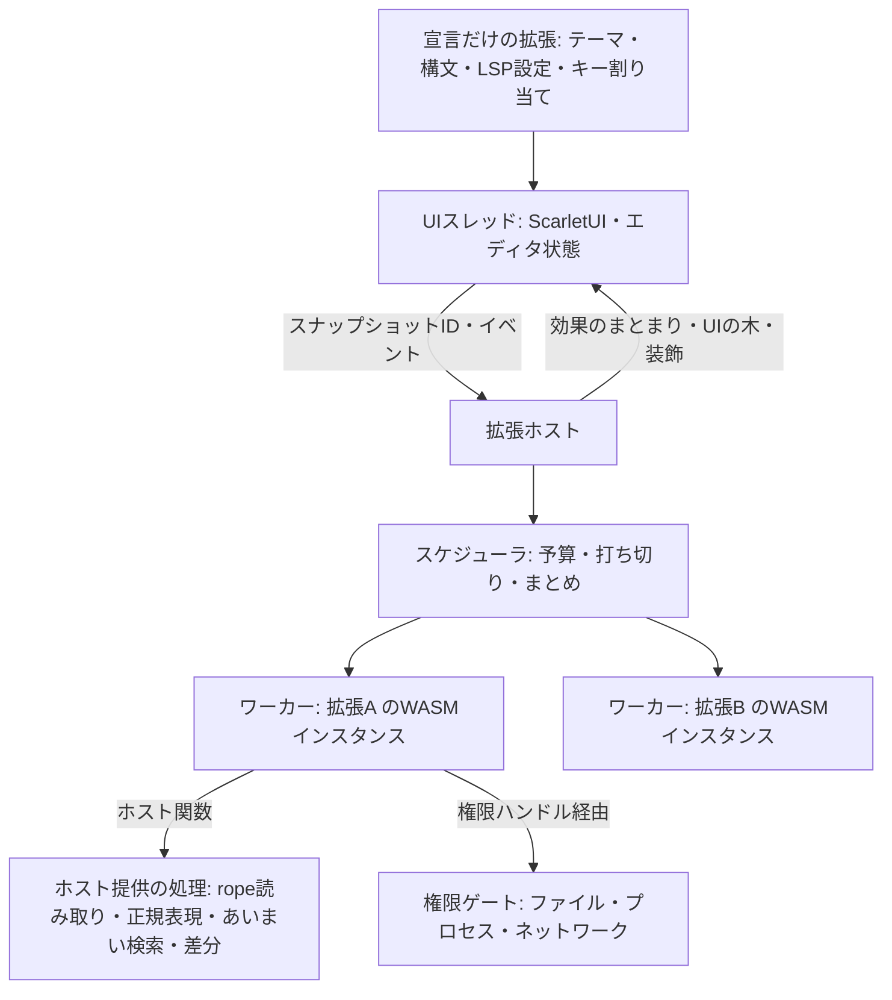

# 拡張機能の設計

2026-11-11。設計案。数値(予算、上限)はすべて仮の値で、
Scarlet実機と開発機で測ってから決める。実装済みの範囲は末尾の「実装状況」を参照。

## 結論

**拡張はWASMで動かし、描画も権限もホストが握る。**
拡張は「データを返す関数」と「権限つきの非同期タスク」だけを書く。
UIは部品の木をデータで返し、ホストがScarletUIで描く。
宣言だけで済む拡張(テーマ、構文定義、LSP設定)はコードを実行しない。

目標は次の3つ。

- 拡張がどれだけ遅くても、入力・スクロール・描画が止まらない。
- 拡張は、マニフェストで宣言し許可された範囲の外に一切触れない。
- 同じ拡張パッケージが macOS / Linux / Scarlet(aarch64, riscv64)で動く。

対象外。

- 拡張による自由な描画(WebView)を標準にすること。逃げ道としてだけ残す。
- 拡張同士の直接呼び出し。必要になったら型つきの公開インターフェースを別に設計する。
- Node / VS Code拡張との互換。

## 全体構成



- UIスレッドはWASMを実行しない。`lsp::Client` と同じく、チャネルで送り `poll` で受け取る。
- 拡張1つにつきWASMインスタンス1つ。メモリ上限と実行量の上限を個別に持つ。
- 拡張が落ちても、その拡張の表示が消えるだけでエディタは続行する。

## 拡張の2段階

| 段階 | 中身 | 実行されるコード |
| --- | --- | --- |
| 宣言だけ | テーマ、構文定義(`.sublime-syntax`)、言語設定、LSPサーバーの起動設定、スニペット、キー割り当て | なし |
| ロジックつき | 上記に加えて `.wasm` | 必要になった時点で初めてインスタンス化 |

ロジックつき拡張の起動条件はマニフェストに書く(特定言語のファイルを開いた、
コマンドが呼ばれた、ビューが表示された)。起動時に全拡張を走らせることはしない。

## マニフェスト

```toml
[extension]
id = "example.todo-highlight"
name = "TODO Highlight"
version = "0.1.0"
api = 1                      # ホストAPIの世代。合わなければ読み込まない
wasm = "extension.wasm"      # 宣言だけの拡張では省略

[activation]
languages = ["rust", "markdown"]
commands = ["todo.list"]

[capabilities]               # 書かなければ何もできない
workspace = "read"           # "none" | "read" | "read-write"
process = []                 # 起動してよい実行ファイル名
network = []                 # 接続してよいホスト名
clock = false                # 時刻・乱数。falseならクエリは決定的になる

[[contributes.commands]]
id = "todo.list"
title = "TODOを一覧表示"

[[contributes.views]]
id = "todo.panel"
title = "TODO"
location = "side"            # "side" | "bottom" | "tab"

[[contributes.themes]]
path = "themes/dark.toml"

[[contributes.language_servers]]
language = "rust"
command = "rust-analyzer"    # capabilities.process にも必要

[[contributes.keybindings]]  # 自分のコマンドだけ。Altを含むか、ファンクションキー
command = "todo.list"
key = "Alt+Shift+T"

[[contributes.formatters]]   # Format Document と保存時の整形を引き受ける
languages = ["markdown"]
```

## 入口は2種類

### クエリ(副作用なし)

ホストが必要なときに呼ぶ関数。入力はスナップショットIDと範囲、出力はデータ。

| クエリ | 返すもの |
| --- | --- |
| `decorations(snapshot, range)` | 装飾の範囲と種類 |
| `completions(snapshot, position)` | 補完候補 |
| `hover(snapshot, position)` | ホバーの中身(Markdownまたは部品の木) |
| `view(view_id)` | UIの部品の木 |
| `rows(view_id, list_id, range)` | 長いリストの見えている行 |

決まりごと。

- 権限が必要なホスト関数は呼べない。読めるのはスナップショットと自分の状態だけ。
- 見えている範囲だけ呼ぶ。結果は (拡張の状態の版, スナップショット, 範囲) でキャッシュする。
- 新しい入力が来たら実行中の呼び出しを打ち切る。
- 予算(仮: 1回 2ms 相当の実行量)を超えたら打ち切り、古い結果を表示し続ける。
  超過が続く拡張は呼び出し頻度を下げ、UIに「遅い拡張」として表示する。

### タスク(副作用あり)

コマンド実行、保存時の整形、外部ツール呼び出しなど。

- 非同期で動き、キャンセルできる。進捗を報告できる。
- 権限つきのホスト関数はここからだけ呼べる。
- 文書の変更は「効果のまとまり」として返す。ホストは対象文書の版が一致するときだけ
  一括適用する。一致しなければ破棄してタスクに通知する。undoは1単位になる。

```text
Effects {
  base: { document, version },
  edits: [ { range, text } ],
  diagnostics: [...],
  notifications: [...],
}
```

## テキストの受け渡し

- バッファは `lapce_xi_rope` の rope で、複製がほぼ無料。編集のたびに版を進め、
  拡張にはスナップショットIDだけ渡す。
- 拡張は `read(snapshot, range)`、`line(snapshot, n)`、`len(snapshot)` で必要な分だけ読む。
- 文書全体を毎回送らない。UIスレッドのロックも要らない。
- スナップショットは参照している呼び出しが終わったら解放する。

## ホストが提供する処理

WASM側は薄く保ち、重い処理はネイティブで実行する。Scarletではインタプリタ実行に
なるため、ここが速度を決める。

| 分類 | 関数の例 |
| --- | --- |
| テキスト | 範囲読み取り、行と位置の変換、正規表現検索(スナップショットに対して直接) |
| 検索 | あいまい検索、ワークスペース内検索 |
| 構文 | トークン種別の問い合わせ(既存の `syntax.rs` の結果を公開) |
| 差分 | 2つのテキストの差分から編集列を作る |
| 設定 | 拡張ごとの名前空間の設定値 |

最初の品揃えは実際に作る拡張2〜3個から逆算して決める。

## 権限

- 権限は「ハンドル」で渡す。拡張は任意のパス文字列を開けない。
  `workspace = "read"` なら、ワークスペース直下を指す読み取り専用ハンドルを1つ受け取る。
  `..` やシンボリックリンクでの外部への到達はホスト側で拒否する。
- プロセス起動は宣言した実行ファイル名だけ。引数と作業ディレクトリはタスクが指定する。
- ネットワークは宣言したホスト名だけ。Scarletでは当面未対応として `unsupported` を返す。
- 時刻と乱数も権限。なければクエリは決定的で、テストと再現が容易になる。
- インストール時と更新で権限が増えた時に、ホストが描くダイアログで確認する。
- 拡張ごとの実行時間、メモリ、打ち切り回数を記録し、設定画面で見られるようにする。

## GUI

4段階に分ける。1と2で大半をまかなう。

| 段階 | 内容 | 時期 |
| --- | --- | --- |
| 1. 差し込み口 | コマンド、ステータスバー項目、コンテキストメニュー、選択リスト、通知、入力ボックス | 最初 |
| 2. 宣言的ビュー | 部品の木を返し、ホストがScarletUIで描く | 2番目 |
| 3. キャンバス | 描画命令の列を返す。クリック判定は領域単位 | 後から |
| 4. WebView | `docs/webview.md` の `myrica-webview` を権限つきで開放 | 未定 |

### 宣言的ビュー

`view(view_id)` は拡張の状態から部品の木を返すクエリ。拡張は状態が変わったら
`invalidate(view_id)` を呼ぶだけで、ホストが1フレームに1回にまとめて `view` を呼ぶ。

最初の部品。

| 部品 | 主な属性 | 届くメッセージ |
| --- | --- | --- |
| `column` / `row` | 間隔、揃え、子 | なし |
| `text` | 文字列、強調、色の役割(テーマの名前で指定) | なし |
| `button` | ラベル、アイコン、無効 | 押された |
| `input` | 初期値、プレースホルダ | 変更(まとめて)、確定 |
| `list` | 件数、行の高さ種別 | 行の選択、行の実行 |
| `tree` | ルートの件数 | 開閉、選択、実行 |
| `separator` / `spacer` | なし | なし |

後から足す候補: `table`、`image`、`markdown`、`checkbox`、`select`、`progress`。

決まりごと。

- 操作中の状態(スクロール位置、フォーカス、入力欄の中身、ホバー、選択)はホストが持つ。
  文字入力やスクロールでWASMを待たない。IMEもホストが処理する。
- 部品にはキーを付ける。ホストは前回の木との差分だけ反映する。
- `list` と `tree` は件数だけ返し、行は `rows` クエリで見えている範囲だけ引く。
- 色と文字サイズは直接指定させず、テーマの役割名(`text.muted`、`accent` など)で指定させる。
- メッセージは `(view_id, key, 種別, 値)` の形でタスクとして届く。

### エディタ内の表示

ビューとは別の専用データ型にする。

| 種類 | 内容 |
| --- | --- |
| 範囲の装飾 | 文字色、背景、下線(テーマの役割名で指定) |
| 行頭の印 | アイコンと色 |
| 行内のヒント | 行末または位置指定の補助テキスト |
| 行間のブロック | 行の下に差し込む部品の木(高さはホストが決める) |

### 画面上の安全

- 拡張は自分のビューの中にしか描けず、他の画面の内容は読めない。
- 入力イベントは自分のビューにフォーカスがある間だけ届く。
- 権限の確認などホストのダイアログは拡張から出せない。拡張のビューには拡張名を表示する。

## ランタイムとABI

- 最初は全プラットフォームで **wasmi**(純Rustのインタプリタ)。Scarletへの移植が最も軽く、
  実行量の上限(fuel)とメモリ上限を備える。
- ABIはランタイムに依存させない。デスクトップで後からJIT(wasmtime)に差し替えられる。
- コンポーネントモデル / WITは使わない(wasmiが未対応のため)。型定義はRustのSDKクレートを正とする。

拡張が公開する関数。

```text
kx_alloc(len: u32) -> ptr: u32
kx_free(ptr: u32, len: u32)
kx_call(ptr: u32, len: u32) -> u64        // 上位32bit=ptr、下位32bit=len
```

ホストが公開する関数(インポート元のモジュール名は `kureha`)。

```text
kx_host(ptr: u32, len: u32) -> i64        // 要求を処理し、返事の長さを返す(負なら失敗)
kx_host_take(ptr: u32, len: u32) -> i32   // 保留中の返事を拡張のメモリへ書き込む
```

- ホストが拡張の `kx_alloc` を呼び返すと再入になるため、返事は「長さを受け取る →
  拡張が確保 → `kx_host_take` で写す」の2段階で渡す。
- `kx_call` に渡したバッファと、`kx_call` が返したバッファは、どちらもホストが `kx_free` で解放する。
- 拡張が `kureha` の2関数以外をインポートしていたら読み込まない(WASIも渡さない)。
- 引数と戻り値は1つのメッセージをバイト列にしたもの。段階2ではJSONにした(既存の依存だけで済み、
  デバッグしやすい)。枠組みは形式に依存しないので、速度が問題になればpostcardへ替えられる。
- `kx_call` に渡すメッセージ: `Activate`、`Query`、`TaskStart`、`TaskEvent`、`UiMessage`、`Deactivate`。
- タスク中の待ちが発生する操作(ファイル読み書き、プロセス、ネットワーク)は、
  `kx_host` が要求IDだけ返し、完了時にホストが `TaskEvent { id, result }` で起こす。
  SDKはこれを `async fn` として見せる。WASMのスレッドは使わない。
- クエリ中は待ちが発生する操作を呼べない。呼んだら即エラーを返す。

## スケジューラ

- 拡張ごとにキューを持つ。文書変更の通知は最新の1件にまとめる。
- 優先順位: UIメッセージ、見えている範囲のクエリ、タスク、見えていない範囲の先読み。
- ワーカーは少数のスレッドプール。Scarletではコア数に合わせて1〜2本。
- メモリ上限(仮: 64MB)を超えた確保は失敗させる。繰り返し落ちる拡張は無効化して通知する。

## 配布

- `extension.toml`、`.wasm`、アセットを1つのアーカイブにする。
- 取得元とSHA-256を固定する。PR #15 で入れるアーカイブとチェックサムつき
  マニフェストの仕組みと同じ考え方にそろえる。
- 配置先はユーザー設定ディレクトリの `extensions/<id>/<version>/`。更新は新しい版を
  展開してから切り替え、失敗したら前の版に戻す。
- 開発用に、ローカルディレクトリをそのまま読み込む方法を用意する。

## 進め方

1. 宣言だけの拡張。拡張ディレクトリの走査、マニフェスト、テーマ・構文・LSP設定の読み込み。
2. wasmiホストの最小版。`decorations` クエリ1種類と、コマンドのタスク1種類。
   ここでScarlet実機と開発機の両方で予算に収まるか測る。成立しなければABIと
   ホスト提供の処理を見直す。
3. 差し込み口(ステータス項目、選択リスト、通知)と権限ゲート。
4. 宣言的ビュー。部品は `column`、`row`、`text`、`button`、`input`、`list`、`tree` から。
5. Rust向けSDKクレートとサンプル拡張。API世代を1として固定する。
6. キャンバス、配布の自動更新、JITへの差し替えは需要が出てから。

## 未決事項

- メッセージ形式。段階2はJSONで実装した。postcardへ替えるかは、Scarletでの測定次第。
- 予算の単位。wasmiのfuelを時間に換算するか、実行量そのままで管理するか。
- 構文情報をどこまで公開するか。syntectのスコープ名をそのまま出すと将来の差し替えが難しくなる。
- 保存時の整形のように「結果を待つ」必要がある場面の扱い。待ち時間の上限と、超えた場合の挙動。
- 拡張の状態を再起動後に引き継ぐ保存領域を、最初のAPIに含めるか。
- Rust以外の言語でのSDK(少なくともABIの文書化)をいつ用意するか。

## 実装状況

### 段階1: 宣言だけの拡張(実装済み)

`src/extensions.rs`。WASMはまだ実行しない(`wasm` はパスの検証だけ)。

- 置き場所は `KUREHA_EXTENSIONS_DIR`、なければ `$XDG_CONFIG_HOME/kureha-code/extensions`
  (`XDG_CONFIG_HOME` が空なら `~/.config`)。その直下のフォルダごとに `extension.toml` を読む。
  `.` で始まるフォルダは無視する。版ごとのフォルダ(`<id>/<version>/`)はインストーラと一緒に入れる。
- 起動時にワーカースレッドで一度だけ読み込む。UIスレッドは読み込み済みかどうかだけを見て、
  ディスクに触れない。変更を反映するには再起動が必要。
- マニフェストは未知のキーを拒否する。`api` が一致しないもの、id が重複したものは読み込まない。
  読み込めなかった拡張はステータスバーに1行で報告する。
- パスは相対パスだけ受け付け、シンボリックリンクで拡張フォルダの外へ出るものを拒否する。

反映される貢献。

| 貢献 | 反映先 | 優先順位 |
| --- | --- | --- |
| `themes` | テーマ選択の一覧、設定ファイルの `color_theme` / `code_theme` | 同名なら組み込みテーマが優先 |
| `languages` | ファイル拡張子から言語IDへの対応 | 組み込みの対応が優先(`.rs` などは奪えない) |
| `language_servers` | LSPサーバーの起動設定 | 環境変数 `KUREHA_LSP_<LANG>` > `lsp.toml` > 拡張 > 組み込み |

`language_servers` の `command` は `[capabilities] process` にも書かれていないと読み込まない。
`commands`、`views`、`activation`、`capabilities` の残りは解析と検証のみで、まだ使われない。

### 段階2: wasmiホストの最小版(実装済み)

`src/extensions/runtime.rs`(1拡張のインスタンス)、`src/extensions/host.rs`(ワーカー)、
`src/extension_ui.rs`(コマンドパレットと結果の適用)。

- wasmi 2.0。デスクトップは `auto-dispatch`、Scarletは末尾呼び出しの最適化に頼らない
  `portable-dispatch`。`wat` はテスト専用で、配布物と謝辞には入らない
  (`about.toml` で開発用依存を除外)。
- WASMは専用スレッド `extension-host` だけで動く。UIは要求を送り、`poll_extensions` で返事を受け取る。
  拡張は最初に使われたときにインスタンス化して `activate` を送る。
- 1回の呼び出しごとにfuelを設定する。既定値は `Budgets::default()`(起動 2000万、
  クエリ 200万、タスク 10億)。メモリは64 MiB、`.wasm` は16 MiB、メッセージは1 MiBまで。
  タスクは当初1億にしたが、Text Toolsで192 KiBのJSON整形が2.7億を使ったため10億に上げた。
- ホスト関数の処理もfuelで払わせる(1回1万 + 読み書きしたバイト数×4)。払えなければ予算超過になる。
  これがないと、拡張が `read` を繰り返すだけでワーカーを占有できてしまう。
- 予算超過やトラップで止まったインスタンスは、状態が壊れている可能性があるので捨てて次回作り直す。
  予算超過が3回続いた拡張は再起動まで無効にする。
- 拡張から来たポインタと長さはすべて範囲検査する。編集と装飾の範囲は、スナップショットの
  文字境界にあり、重ならないことを確かめてから使う。
- ホストの関数は `read`(呼び出し中のスナップショットから範囲を読む)と `log` だけ。
  権限が要る操作はまだない。
- コマンドは、マニフェストに `wasm` がある拡張のものだけをコマンドパレットに
  「拡張名: タイトル」で出す。行のキーは `ext:<拡張id>:<コマンドid>` で、組み込みと衝突しない。
- コマンドの編集は、言語サーバーの編集と同じ確認を通して1回のundoで適用する。
  実行中に文書や作業中のエディタが変わっていたら捨てて、ステータスバーに理由を出す。
- テキストは rope のスナップショットではなく、`Arc<String>` の複製を渡している。

`decorations` クエリは、ABI・検証・予算までは実装してテストしたが、エディタへの描画はまだない。

計測(Apple Silicon、macOS、リリースビルド)。

- fuelは命令の数え方で決まり、プラットフォームによらず同じ値になる。予算に対する余裕(fuelの割合)は
  Scarletでも変わらず、変わるのは実時間だけ。
- 1 msあたりのfuelは処理で違う。空ループは約230万fuel/ms(`fuel_throughput`)、Text Toolsの実際の
  コマンドは約450万〜970万fuel/ms。空ループから時間を見積もると長めに出る。
- 既定のタスク予算(10億)は、このMacで約0.1〜0.2秒に当たる。
- upper-caseの例で100 KBの選択範囲を大文字にすると、1回約1.3 ms。
- Text Toolsの入力上限(192 KiB)での各コマンドは次のとおり(`text_tools_budget`)。

| コマンド | fuel | タスク予算に対して | 時間 |
| --- | --- | --- | --- |
| Convert to snake_case(184 KiB) | 4.99億 | 50% | 63 ms |
| Format JSON | 2.72億 | 27% | 57 ms |
| Minify JSON | 1.53億 | 15% | 30 ms |
| URL Encode(184 KiB) | 1.01億 | 10% | 16 ms |
| Sort Lines | 0.84億 | 8% | 17 ms |
| Trim Trailing Whitespace / Count / Base64 Encode | 0.47億〜0.49億 | 5% | 5〜10 ms |

**Scarlet実機での計測はまだで、段階2の関門(予算内に収まるか)は未確認。** 予算の値はその結果で見直す。

実アプリの経路の確認: `cargo test --bin kureha-code extension_command_end_to_end -- --ignored`
(`KUREHA_EXTENSIONS_DIR` にビルド済みの例を置く)。本物のコマンドパレット、ワーカー、例の拡張を通し、
選択範囲が大文字になり1回のundoで戻ることを確かめる。`KUREHA_WORKBENCH_PREVIEW` を指定すると画面をPNGで保存する。
macOSのデバッグビルドで、Enterから編集の適用まで初回読み込み込みで約25 ms。

例とSDK(どれも本体のビルド、`Cargo.lock`、謝辞、CI、`nix build` の対象外):

- `examples/extensions/sdk`(`kureha-extension`): ABIの糊だけを切り出した最小のSDK。
  バッファのエクスポート、`kx_host` の2段階呼び出し、JSONの読み書きを隠し、`export!(handler)` で
  エクスポートを生成する。FFIは `wasm32` のときだけ有効なので、変換処理はネイティブでテストできる。
- `examples/extensions/text-tools`: 実用向けの例。行の並べ替え・重複削除・反転、行末空白の削除、
  JSONの整形・圧縮(キー順と数値の表記を保つ)、大文字小文字や snake_case などの変換、
  Base64・URLのエンコードとデコード、行数・単語数・文字数。行のコマンドは選択行(なければ文書全体)、
  変換系は選択範囲だけに効く。CRLFと末尾の改行を保ち、入力は192 KiBまで。
- `examples/extensions/upper-case`: 最小の例。選択範囲を大文字にする。

`examples/extensions/upper-case` は選択範囲を大文字にする拡張で、SDKを使って書いている。
`cargo test real_guest -- --ignored` に `KUREHA_TEST_EXTENSION_WASM` を渡すと、ビルド済みの
モジュールをランタイムに通して確かめられる。

実アプリの経路では `text_tools_end_to_end` も同様に、コマンドパレットからJSONの整形と
CONSTANT_CASEへの変換を実行し、2回のundoで元に戻ることを確かめる。

### 段階3: キー割り当てと整形の枠組み(実装済み)

**キー割り当て**(`contributes.keybindings`)

- 自分の拡張のコマンドにだけ付けられる。書式は組み込みと同じ `Alt+Shift+S`、`Primary+Alt+L`、`F6`。
  `Primary` はmacOSでCommand、それ以外でCtrl。キーの連続(`Primary+K Primary+T`)は不可。
- 拡張が使えるのは **Altを含む組み合わせか、ファンクションキー** で、キーは英字・数字・F1〜F24。
  組み込みのショートカットはほぼAltを使わないので衝突しにくく、普通の文字入力も奪わない。
- 組み込みと重なるものは読み込み時に捨てる。対象はコマンドパレットとメニューに載るもの全部、
  載っていない組み込み(Alt+Z、Alt+Shift+F、F1/F2/F3/F12 など)、Primaryと一緒なら他の修飾キーに
  関係なく取られるキー(N、O、S、W、数字など)。拡張どうしで重なったら先に読み込んだ方が勝つ。
  捨てたものはステータスバーに1回だけ出す。
- 効くのはコードエディタにフォーカスがある間だけ(VS Codeの `editorTextFocus` 相当)。
  検索欄・名前の変更・ターミナルでは効かない。Altの後に一部の環境が送ってくる文字は捨てる。
- コマンドパレットの行にショートカットを表示する。

**整形の枠組み**(`contributes.formatters`)

- 拡張は「この文書全体を整形した編集を返す」だけを実装する(ABIの `"kind": "format"`。
  `options` に言語サーバーへ渡すのと同じ `tab_size` と `insert_spaces`)。どのコマンドで呼ぶか、
  いつ呼ぶか、どの整形器を使うかはホストが決める。
- 組み込みの **Code: Format Document**(Alt+Shift+F)は、その言語の整形器が拡張ならそちらを、
  そうでなければ従来どおり言語サーバーを使う。拡張がなければ動作は今までと同じ。
- 選び方: 設定ファイルの `[formatter]` に言語ごとに `"lsp"` か拡張のidを書けばそれ。書かなければ
  最初に読み込まれた拡張の整形器、なければ言語サーバー。成功すると「Formatted with 拡張名」と出す。
- **保存時の整形**(設定の `format_on_save`、設定画面にトグル): 保存を一度止め、整形を当ててから書き込む。
  - どう失敗しても保存はする。整形器のエラー、予算超過、途中で文書が編集された場合は整形せずに保存し、
    「Saved 名前 · not formatted: 理由」と出す。
  - 1.5秒で返事がなければ整形せずに保存し、遅れて来た返事は捨てる(保存後に文書を変えない)。
  - 整形待ちの間にもう一度保存しても、整形を二重に始めない。
  - 閉じるときの「保存しますか」から保存する場合は待たない。「すべて保存」も今は整形しない。
  - 言語サーバーの整形はまだ保存時に走らない(その旨を1回だけ表示する)。
- 例: Text ToolsはJSONの整形器になり、Alt+Shift+S/D/U/L/C のキー割り当てを持つ。

確認: `extension_ui` のテストで、組み込みや重複の除外、キーからのコマンド実行、Altの後の文字の破棄、
整形器の選択と `[formatter]` による切り替え、保存時の整形(成功、エラー、途中の編集、時間切れと遅れた返事、
閉じるときの保存)を確かめる。`text_tools_formatter_and_keys_end_to_end` は実際のText Toolsで
Format Document、保存時の整形、Alt+Shift+S、パレットのショートカット表示を通す。

今のAPIでできないこと: 時刻・乱数(UUIDや日時の挿入)、ファイルやプロセスへのアクセス
(Prettier・rustfmt・ruffのような外部ツールの整形器はまだ作れない)、拡張ごとの設定、装飾の描画。

### 次にやること

- プロセス起動の権限と非同期のホスト呼び出し。外部ツールを使う整形器(Prettier、rustfmt、ruff)と
  リンターの前提。
- 言語サーバーの整形を保存時にも使う。「すべて保存」でも整形する。
- Scarlet実機でのfuel計測と、予算の見直し。
- `decorations` の結果をエディタに描く(見えている範囲だけ問い合わせ、版でキャッシュ)。
- 拡張一覧と読み込みエラーを見られる画面(コマンドパレットの項目から開く)。
- SDKの公開とバージョン管理(今は例の中にある最小版)。
