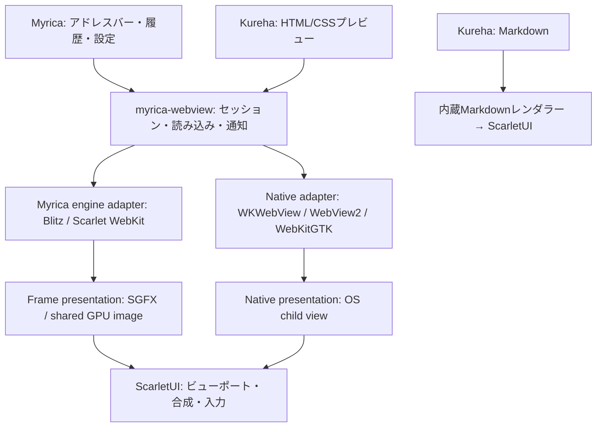

# 共通WebViewとKurehaプレビューの設計

2026-11-09。WebView部分の設計案。Markdownは先に内蔵レンダラーを実装し、
CommonMarkをScarletUIで直接描画する。未保存編集、コードの色分け、表、埋め込み画像に
対応し、ブラウザの起動を必要としない。HTML/CSS表示は引き続きこのWebView設計で扱う。

## 結論と所有範囲

**Myricaをブラウザアプリと再利用可能なWebViewに分け、Kurehaはその利用者にする。**
ScarletUI本体はブラウザエンジンに依存させない。必要な表示・入力連携だけを提供する。
プラットフォームによってネイティブWebViewも選べるようにし、エンジンと表示経路を区別する。

当初はMyricaリポジトリ内に `myrica-webview` と `myrica-webview-scarlet-ui` を置く。
バックエンドはfeatureで選択し、需要が出るまで細かいクレート分割は増やさない。
ブラウザの設定画面、アドレスバー、Widevine設定、アプリ終了方針はライブラリへ移さない。
KurehaにMyricaのソースをコピーしたり、Myrica実行ファイルを埋め込んだりしない。

## 既存実装から使えるものと不足

調査基準はMyrica `09b9414b5e2c9f8e645133cf7251e5e670a27eaf`。
既に `BrowserBackend`、`BrowserWorker`、`BrowserFrameSource`、`BrowserInputSink` がある。
UIスレッドでHTML/JS/layoutを実行しないこと、古いnavigation/viewportのフレームを捨てること、
GPU画像のleaseを返すことを維持して公開部品に抽出する。
[backend boundary](https://github.com/petitstrawberry/myrica/blob/09b9414b5e2c9f8e645133cf7251e5e670a27eaf/src/backend/mod.rs)、
[worker](https://github.com/petitstrawberry/myrica/blob/09b9414b5e2c9f8e645133cf7251e5e670a27eaf/src/backend/worker.rs)。

現在はバイナリアプリ内のモジュールで、`BrowserBackend` のトップレベル読み込みは
`navigate(location)`。そのままKurehaから使える公開WebView Viewや、未保存HTMLを渡す
共通APIにはなっていない。`app.rs` にあるページ表示、geometry、focus、IME、入力変換と
フレーム提示をアドレスバーなどから切り離す。
[app](https://github.com/petitstrawberry/myrica/blob/09b9414b5e2c9f8e645133cf7251e5e670a27eaf/src/app.rs)。

## 公開する契約

次は提案APIであり、既存メソッド名ではない。

| 契約 | 役割 |
| --- | --- |
| `WebSession` | view再生成で壊れないページの所有者。閉じるまでidentityを保持する |
| `load_document(html, base, revision)` | 未保存HTML/CSSの読み込み。最後のrevisionだけを提示する |
| `navigate(url)` / history | 通常のブラウザ用途。Kurehaのコード位置履歴とは独立 |
| `ResourceProvider` | 相対CSS、画像、フォントを非同期で供給。MIME、長さ、キャンセルを扱う |
| `NavigationPolicy` | ページ内リンク、別ファイル、外部URL、新規ウィンドウをアプリへ通知 |
| `WebViewCapabilities` | engine、presentation、script、IME、clip、overlay等の実対応を返す |
| `attach` / `set_viewport` / `set_visible` / `detach` | ペインへの接続、DPI変更、非表示、移動。文書ロードとは分離 |
| `close` / completion | 非同期停止。単一プレビューを閉じてもホストプロセスを終了しない |

`ResourceProvider` は単なる `file://` への書き換えにしない。Kurehaは指定した文書・
ワークスペースの実体パスと未保存バッファから解決し、パーセントエンコード・`..`・
symlinkを含めた解決後の範囲を確認する。CSS中のURLも同じ経路を通す。
WebView側の初期プレビューはJavaScriptとリモート読み込みを無効にする。内蔵Markdownの
HTTP/HTTPS画像は独立した制限付きワーカーで読み込む。HTMLプレビューで
許可する機能は個別の設定とし、Myricaの通常閲覧用cookie/storage profileを共有しない。
プレビューにターミナルや任意ファイル操作のIPCを公開する必要はない。

ネイティブバックエンドを既存の `BrowserWorker` にそのまま入れない。例えばWryの
`WebViewBuilder` は `!Send` / `!Sync` であり、OSのUIスレッド制約を持つ。
公開セッションは非同期コマンド／通知を揃え、実行担当を
`EngineWorker` と `PlatformUi` に分ける。フレーム供給は前者の能力として残す。
[Wry API](https://docs.rs/wry/0.57.1/wry/struct.WebViewBuilder.html)。

## プラットフォーム選択と描画経路

| プラットフォーム | 候補 | 最初の方針 |
| --- | --- | --- |
| macOS | ネイティブWKWebView / Blitz | nativeを既定候補にし、タブ移動・overlay検証後に有効化 |
| Windows | ネイティブWebView2 / Blitz | runtime利用可否とhosting方式を検出。未検証の自動選択はしない |
| Linux | WebKitGTK / Blitz | Winit環境ではBlitzを基準。GTKイベントループとの接続を別途検証 |
| Scarlet AArch64 | MyricaのScarlet WebKit / Blitz | 既存GPU画像経路を再利用。対応featureを明示 |
| その他のScarlet | Blitz | 現在のMyricaの対応範囲を引き継ぐ |

Wryはnative adapterの候補であり、Scarlet用のエンジンではない。Wryの
`build_as_child` はmacOSでNSView、Windowsで子ウィンドウを作り、LinuxではX11のみ。
WaylandはGTK側のホストを必要とするため、「全OSで同じraw handleを渡す」だけでは済まない。
[公式のplatform-specific条件](https://docs.rs/wry/0.57.1/wry/struct.WebViewBuilder.html#method.build_as_child)。

`Presentation::Frame` は既存のSGFX／GPU画像をScarletUIが合成する。
`Presentation::NativeChild` はOSのview/windowを配置する。後者に対して、ScarletUIの
角丸、半透明、クリップ、重なり順が自動的に適用されるとは扱わない。
WindowsもWindowedとVisual hostingでは入力・合成の担当が異なる。
[WebView2 hosting](https://learn.microsoft.com/en-us/microsoft-edge/webview2/concepts/windowed-vs-visual-hosting)。

ScarletUI側に必要になる場合の追加は、エンジン固有でないnative-childのmount/unmount、
window相対の矩形・clip・DPI・visibility・focus通知。HTMLの解釈やブラウザ履歴は持たせない。
コマンドパレット、メニュー、分割ドロップ表示がWebViewに隠れる場合は、そのbackendの
提示方式を採用できるとはしない。native overlayで解決するか、明示的な一時非表示／
スナップショット表示を実装し、同じUI契約のテストを通す。

## Kurehaでの利用

Markdownの標準表示は内蔵レンダラーとする。将来WebView表示を追加する場合には、
KurehaでHTMLに変換し、テーマCSS、コードブロックの色、source位置の目印を添える。
HTMLファイルは同じセッションAPIに直接渡す。編集更新はrevision付きでまとめ、古い更新が
新しい文書を上書きしないようにする。テーマ変更だけでOS WebViewを作り直さない。

編集タブとプレビューは同じ `DocumentId` を参照し、表示状態はペインごとに持つ。
タブを別ペインへ動かす際はWebSessionを保持し、native childの配置先だけを更新する。
将来の別ウィンドウ移動では、backendがreparentを支えなければviewを再作成して位置を復元する。
非表示タブは描画を止め、閉じたらresource要求・worker・leaseを回収する。

画像は現在のネイティブプレビューを使える。HTML内の画像はResourceProviderから供給する。
どちらも同じペイン／タブ操作に参加する。

## 実装順と確認点

1. **Myricaからの抽出**：まず既存ブラウザを同じ共有ライブラリで動かす。engine worker、
   frame lease、入力、IME、終了処理の既存テストを維持する。
2. **文書／resource API**：メモリ上のHTML、未保存CSS、相対画像、load世代、閉じた後の
   遅延応答を検証する。ブラウザアプリの終了方針をセッション終了から分離する。
3. **macOS native adapterの小さい実証**：native childをScarletUIの分割ペインに置き、
   Retina/DPI、スクロール、IME、フォーカス復帰、メニューとパレットの重なり、移動／閉鎖を確認する。
4. **KurehaでHTMLと追加のWebViewプレビューを接続**：ライブ更新、相対resource、テーマ反映、
   コード／プレビュー並列、タブ移動、無効なHTMLでもエディタが操作できることを確認する。
5. **Scarletと他のhost**：同じ契約テストを実エンジンで実行してから既定選択へ加える。

MyricaとKurehaは現在ScarletUIのpinが異なる。共有Viewをリンクする前に互換commitへ揃え、
同名だが別バージョンのState/View/GPU型をまたいで渡さない。Kurehaの最小previewビルドに
ブラウザ全体のmedia/EME/設定機能が付随しないようfeatureの依存も整理する。

## 内蔵プレビューの表示と描画

Markdownプレビューは通常の編集タブから独立したペインで開く。未保存本文を
ライブ更新し、対象ファイルの追従と双方向の位置同期をそれぞれ切り替えられる。
位置はMarkdownブロックのソース行と表示位置の対応から補間する。
デスクトップではsgfx/wgpuで合成し、CPU側で解析・計測したレイアウトを再利用する。
ScrollViewのviewport通知により画面外の描画命令を除き、画像は共有バッファを保つ。
これはHTML/CSS用のWebViewアダプターとは独立した実装である。
